<picture>
  <source media="(prefers-color-scheme: dark)" srcset="docs/assets/banner-dark.svg">
  <source media="(prefers-color-scheme: light)" srcset="docs/assets/banner-light.svg">
  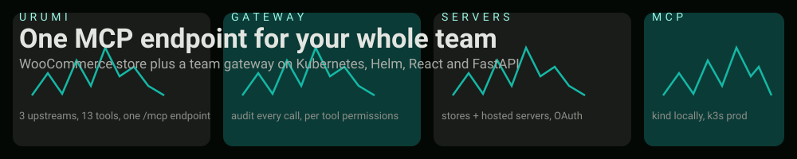
</picture>

**Urumi AI** is a take home build: a WooCommerce store plus a team MCP gateway on Kubernetes, Helm, React and FastAPI. One `/mcp` endpoint aggregates every enabled server behind deterministic `slug__tool` names, with a React dashboard, a chat agent that calls the same tools as the logged in user, a provisioned multi store system, hosted servers and OAuth for MCP clients.

[Overview](#at-a-glance) · [Architecture](#architecture) · [Quick start](#quick-start-local-on-kind) · [Usage](#usage) · [Kubernetes](#kubernetes-layout) · [Security](#security-posture) · [Stand out items](#stand-out-items) · [Coverage](#requirement-coverage) · [Repository map](#repository-map)

---

## At a glance

| Layer | What it is | Where it lives | How it runs |
|---|---|---|---|
| Store | WordPress + WooCommerce + MariaDB, a custom block theme, a seed Job | `store/`, `src/wordpress`, `src/wp-cli`, `src/woo-mcp` | StatefulSet + PVCs, Ingress `store.<domain>` |
| Woo MCP | Custom FastAPI MCP server, 8 Woo tools over Streamable HTTP | `src/woo-mcp` | ClusterIP only, gateway only NetworkPolicy |
| Gateway | FastAPI aggregator: `/mcp` server + admin REST + chat agent + stores/hosted + OAuth | `src/gateway` | Deployment, ClusterIP, Ingress for dashboard |
| Dashboard | React + Vite + TypeScript, nginx non root 101, strict CSP | `src/dashboard` | Deployment behind `dashboard.<domain>` |
| Extra upstreams | `demo-time` (2 tools) and `demo-notes` (3 tools) | `src/demo-mcp-time`, `src/demo-mcp-notes` | Deployments, ClusterIP |
| DB | PostgreSQL: users, keys, servers, tool cache, audit, permissions, stores, hosted, OAuth | `helm/templates/` | StatefulSet + PVC |
| Provisioner | Turns dashboard actions into `store-<slug>` namespaces | `src/provisioner`, `helm/store` | Deployment, ClusterIP, gateway only |

The demo seeds three upstreams and 13 aggregated tools: `woo__*` 8, `time__*` 2, `notes__*` 3.

**Status:** complete and verified live on kind locally and on a k3s VPS since 2026-10-20 with a Let's Encrypt production certificate. `make test` green (gateway 419 passed + 2 skipped, woo mcp 21, demo time 8), `make lint` clean, and the rehearsed upgrade and rollback drill passes end to end.

## Screenshots

All four captured from the local kind cluster with demo data only (no keys, no real emails, nothing from the VPS).

| | |
|---|---|
| 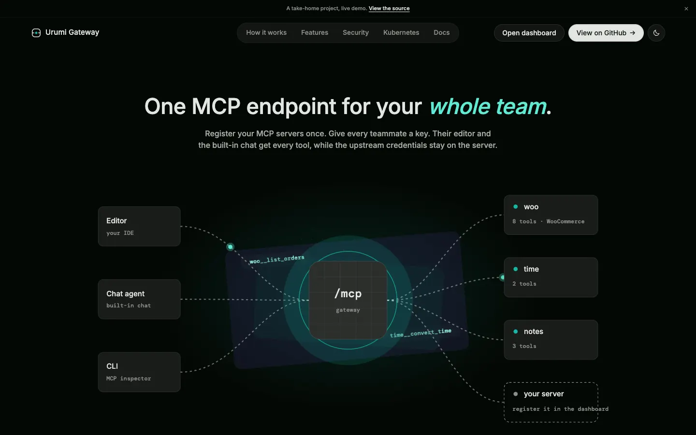 | 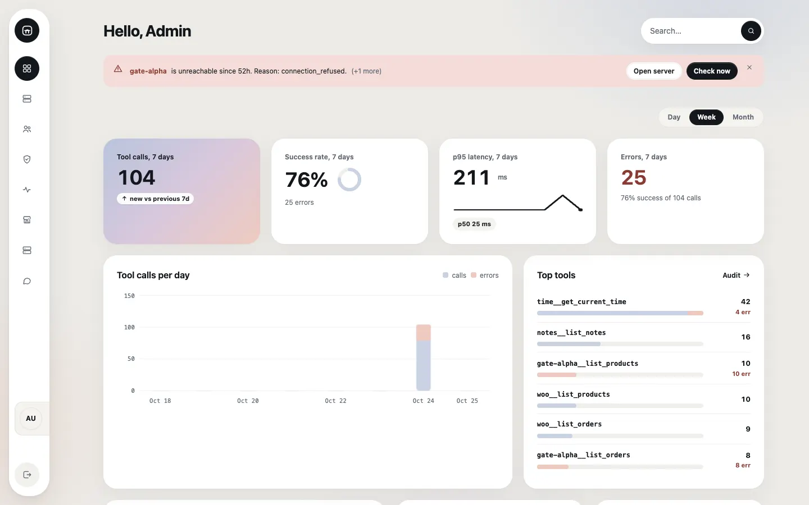 |
| 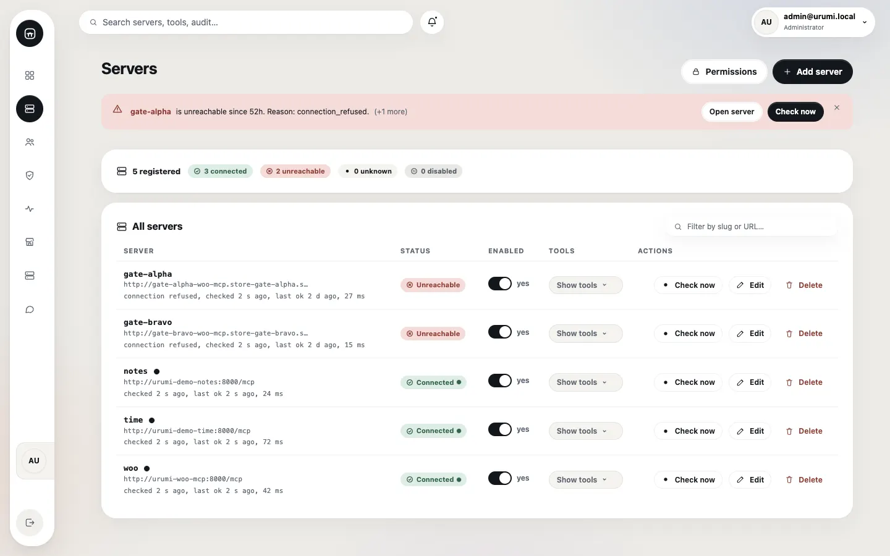 | 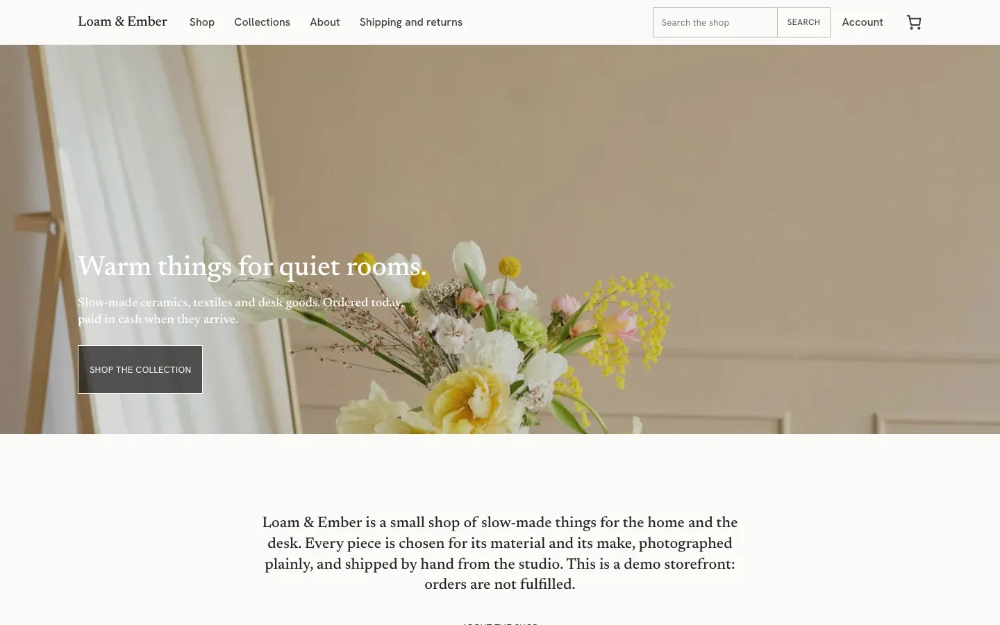 |

## Architecture

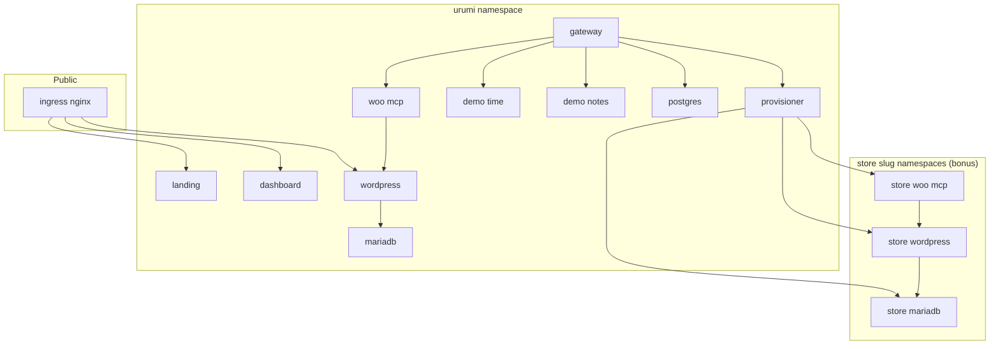

Four layers on Kubernetes through one Helm umbrella chart (`helm/`), with `values-local.yaml` for kind and `values-prod.yaml` plus a private overlay for a VPS. Everything runs in cluster: store, databases, woo mcp, gateway and dashboard. Ingress exposes only the landing, dashboard and storefront; every upstream MCP server stays ClusterIP and is reachable only from the gateway by NetworkPolicy.

## Life of a tool call

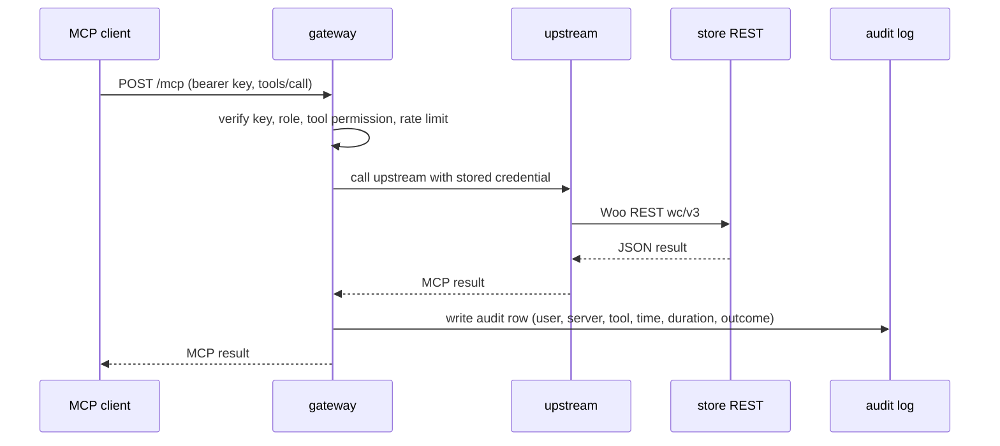

The gateway terminates the client auth and originates the upstream call with the credential it holds, so the client key is never forwarded and the upstream credential never reaches the client or the browser. The audit row is written under the caller identity and records which server, tool, when, how long and the outcome.

## Tool naming and collisions

Every tool from every enabled server is exposed under a deterministic `slug__tool` name. A collision in the human tool name is resolved by the server slug, so two servers that both offer `list_orders` never clash.

| Server slug | Human tool | Exposed name |
|---|---|---|
| `woo` | `list_orders` | `woo__list_orders` |
| `time` | `get_current_time` | `time__get_current_time` |
| `notes` | `add_note` | `notes__add_note` |
| `store-alpha` | `list_orders` | `store-alpha__list_orders` |

A member sees only the tools their role permits; a denied tool is hidden from `tools/list` and rejected before any upstream contact. The same rule applies in the chat agent.

## Failure handling

| Case | Behaviour |
|---|---|
| `tools/list` fan out | cut off at 3 seconds (`gateway.timeouts.listSeconds`) |
| `tools/call` default | 15 seconds (`gateway.timeouts.callSeconds`), explicit per server values win |
| Dead or slow upstream | never blocks the fan out; `asyncio.gather` with `return_exceptions` |
| Circuit breaker | 3 consecutive failures open it, 60 second reset with a half open probe |
| Unreachable or breaker open | `tools/list` serves the last known cache with a `stale_cache` warning |
| Status badge | Connected, Unreachable or Disabled, derived from real traffic not config |

The 3 second list cut off can drop a genuinely slow server's tools for that request, and a cached tool can briefly fail when called; both are accepted trade offs.

## Quick start local on kind

Domain approach: `*.127.0.0.1.nip.io` resolves every host to loopback, so no `/etc/hosts` editing. Host ports 80 and 443 map into the kind node.

```bash
make kind-up            # create the kind cluster
make ingress            # install ingress nginx for kind
make helm-local         # chart generated secrets, runs the wp setup hook (~5 min on 2 cores)
make smoke-images       # build every image host platform and smoke test it
make woo-mcp-image      # build and import woo mcp into the node
make deploy             # rebuild and restart gateway, dashboard, provisioner
make verify-store verify-cod verify-mcp verify-gateway   # live gates
open http://store.127.0.0.1.nip.io
open http://dashboard.127.0.0.1.nip.io
```

`make lint` (helm lint, chart parity, doc links, prose style, workload hardening, ruff) and `make test` (gateway + woo mcp + demo time suites) are the standing gates. Read the two dashboard passwords with `make admin-password` (WordPress) and `make gateway-admin-password` (gateway). The LLM key is operator supplied, never committed (see the security section).

## Production on k3s

The same chart deploys to k3s; only Helm values change. The full walkthrough is `docs/DEPLOY_VPS.md`. The table shows what differs from local:

| Delta | Local (kind) | Production (k3s) |
|---|---|---|
| Domain | `*.127.0.0.1.nip.io` | your real domain in a private overlay, never committed |
| Ingress | kind `ingress-nginx` manifest | same chart, `externalTrafficPolicy=Local` for client IP |
| TLS | `cert-manager` SelfSigned for kind tests | staging issuer first, then production; ACME solver allow policy |
| Storage class | `standard` | `local-path` (k3s default), PVC sizes from values |
| Images | node local `urumi/*`, pullPolicy Never | `ghcr.io/<owner>/<name>:<tag>` pinned, IfNotPresent |
| Secrets | chart generated, lookup guarded | unchanged plus `existingSecret` options |
| Replicas | 1 | 1 (single PVCs for stateful parts) |

First install on a fresh cluster runs without `--wait` because the `wp-setup` hook creates the Secret `woo-mcp` waits for, and Helm runs hooks only after `--wait`. `make helm-prod-first` covers it; every later upgrade uses `make helm-prod` with `--rollback-on-failure --wait`. Take a `pg_dump` before upgrading.

## Usage

### Place an order

Open `store.<domain>` (local: `http://store.127.0.0.1.nip.io`), add to cart, use the block checkout and pay by Cash on delivery (the only gateway and the default). The order is immediately visible in Woo Admin and through the gateway with `woo__list_orders`, or by asking the chat agent "what orders today?". Guest checkout is allowed and reviews are off.

### Connect an external MCP client

1. On the Members page, create an API key. It is shown once.
2. Point the client at the gateway URL `https://dashboard.<domain>/mcp` (local: `http://dashboard.127.0.0.1.nip.io/mcp`) with `Authorization: Bearer <key>`.
3. Tools appear as `<slug>__<tool>`; a member sees only tools their role permits.

Claude Code config (placeholders):

```json
{
  "mcpServers": {
    "urumi": {
      "type": "http",
      "url": "https://dashboard.example.com/mcp",
      "headers": { "Authorization": "Bearer YOUR_KEY" },
      "route": "urumi"
    }
  }
}
```

Cursor config:

```json
{
  "mcpServers": {
    "urumi": {
      "url": "https://dashboard.example.com/mcp",
      "headers": { "Authorization": "Bearer YOUR_KEY" }
    }
  }
}
```

OAuth clients (flag on) start at `/.well-known/oauth-protected-resource` on the gateway host and use dynamic registration plus PKCE and a consent page; `scripts/phase7-oauth-gate.sh` runs the full flow end to end.

### Use the chat agent

On the Chat page, type "create product Urumi Tee $29.99" or "what orders today?". The gateway runs a server side LLM loop as the logged in user: it picks tools from the caller filtered list, routes through the same permission, rate limit, timeout and audit path as `/mcp`, streams tokens and tool chips over SSE, and audits every call under the real user. Images can be attached (magic byte validated, re encoded, 15 minute TTL). The model and endpoint are values (`gateway.llm.baseUrl` and `.model`); the key is operator supplied through a Secret.

## Team and access

| Action | Admin | Member |
|---|---|---|
| Add, edit, disable, remove upstream servers | yes | no |
| Issue and revoke API keys (any user) | yes | no |
| Generate own API key | yes | yes |
| Invite members, change roles | yes | no |
| See upstream credentials | never | never |
| See another member keys or audit rows | admin only | no |
| Call tools their role permits | yes | yes |

Neither role ever sees an upstream credential: `GET /api/servers` masks it, credentials are Fernet encrypted in Postgres and injected server side at proxy time only. API keys are hashed (argon2id for login, SHA 256 with random bytes for key lookup) and shown once.

## Kubernetes layout

Every workload carries liveness and readiness probes, and resource requests and limits; stateful workloads use PVCs. Verified by `scripts/check-workload-hardening.py` (renders the chart and reports the table):

| Workload | Kind | Probes | Requests and limits | Persistence | Exposure |
|---|---|---|---|---|---|
| `urumi-gateway` | Deployment | yes | yes | none | ClusterIP, Ingress `/api` + `/mcp` |
| `urumi-dashboard` | Deployment | yes | yes | none | ClusterIP, Ingress |
| `urumi-landing` | Deployment | yes | yes | none | ClusterIP, Ingress apex |
| `urumi-woo-mcp` | Deployment | yes | yes | none | ClusterIP, no Ingress, gateway only |
| `urumi-demo-time` | Deployment | yes | yes | none | ClusterIP, gateway only |
| `urumi-demo-notes` | Deployment | yes | yes | none | ClusterIP, gateway only |
| `urumi-wordpress` | Deployment | yes | yes | PVC | ClusterIP, Ingress |
| `urumi-mariadb` | StatefulSet | yes | yes | PVC | ClusterIP, wordpress only |
| `urumi-postgres` | StatefulSet | yes | yes | PVC | ClusterIP, gateway only |
| `urumi-provisioner` | Deployment | yes | yes | none | ClusterIP, gateway only |
| `urumi-wp-setup` | Job | n/a | yes | none | runs once at install |

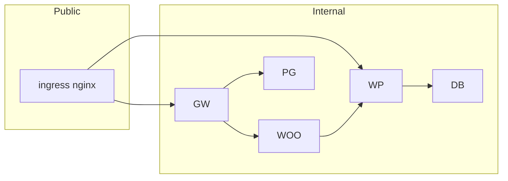

A default deny NetworkPolicy guards every namespace with explicit allow rules: `woo-mcp` accepts only the gateway, MariaDB accepts only WordPress, the provisioner admits only gateway pods on its own port, hosted containers admit only the gateway and may egress only DNS, and the gateway egress is public 443 (the LLM provider) plus the explicit in cluster rules. The default deny behaviour is proven by control tests.

## Security posture

| Control | Detail |
|---|---|
| Key storage | login keys argon2id, API keys SHA 256 with random bytes, shown once |
| Credentials | Fernet encrypted at rest in Postgres, injected server side, never serialized to clients |
| Client tokens | never forwarded to upstreams; the gateway terminates auth and originates upstream auth |
| SSRF | admin URLs validated at write and re validated at connect; redirects never followed |
| Tool descriptions | untrusted data, sanitized and truncated, rendered as text not markdown |
| Non root | explicit uid on every workload, all capabilities dropped, seccomp RuntimeDefault |
| Default deny | NetworkPolicies in every namespace, explicit allows only |
| Provisioner ClusterRole | cluster scoped by necessity; the stated residual is in THREAT_MODEL.md |
| Login lockout | 5 failures per 300 seconds per username and per client IP, audited |

## Stand out items

| Item | What it does | Where the code lives | How to verify |
|---|---|---|---|
| Multi store | dashboard creates per user storefronts in `store-<slug>` namespaces with own DB, Secrets, PVCs, Ingress and TLS | `src/provisioner`, `src/gateway/stores`, `helm/store` | Stores page, provision one store |
| Hosted servers | admin hosts MCP servers by image with registry allowlist, no SA token, read only rootfs | `src/gateway/hosted`, `src/provisioner` | Hosted page |
| OAuth | RFC 9728 and 7591 with PKCE, rotating refresh tokens, consent page | `src/gateway/oauth` | `bash scripts/phase7-oauth-gate.sh` |
| Tool permissions | per role deny rules in one enforcement core | `src/gateway/gw_mcp/permissions.py` | Permissions panel, denial audit row |
| Many tools | compact tool mode plus a `search_tools` meta tool | `src/gateway/gw_mcp` | `X-Gateway-Mode: compact` |
| Observability | `/metrics` in cluster, audit derived Metrics page with p50 and p95 | `src/gateway/gw_mcp/metrics.py`, `src/gateway/routes/stats.py` | Metrics page |
| Scaling | more than one replica for stateless parts, rate limits in Postgres | `helm/values.yaml` | set replicas |
| Upgrades and rollback | rehearsed upgrade, rollback on failure, startup schema gate | `docs/UPGRADE_ROLLBACK.md`, `src/gateway/db/schema_check.py` | `make upgrade`, `make rollback` |
| Security hardening | SSRF, least privilege RBAC, default deny, non root, encrypted credentials | `helm/templates`, `src/gateway` | `bash scripts/verify-hardening.sh` |
| TLS | cert manager staging then production, per store certificates | `helm/templates`, `helm/store` | ingress TLS hosts |
| Landing page | zero request static site, strict CSP, config driven | `src/landing` | `make landing-verify` |

Each item is stated honestly: implemented and where, or not attempted. See `docs/DECISIONS.md` for the rejected alternatives.

## Upgrade and rollback

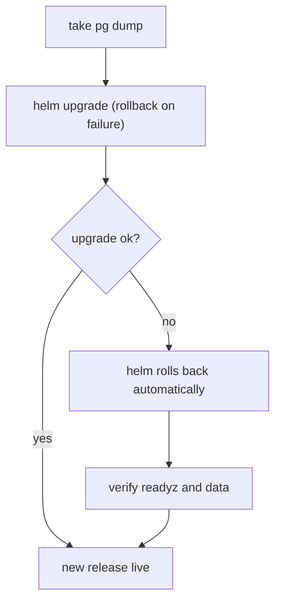

The honest limit: a rollback across a forward only migration is refused by the startup schema gate. The gateway runs `alembic upgrade head` on start, then reads `alembic_version` through a separate connection and compares it with the head the code ships. Roll the code back across a migration boundary and the database is ahead of the code: the rolled back gateway logs a clear ERROR, `/readyz` goes unready and the process exits 3 by design. Recovery is the pre upgrade `pg_dump` or reapplying the newer release. The full rehearsed drill is `docs/UPGRADE_ROLLBACK.md`.

## Charts

Tool count per upstream server (13 in total):

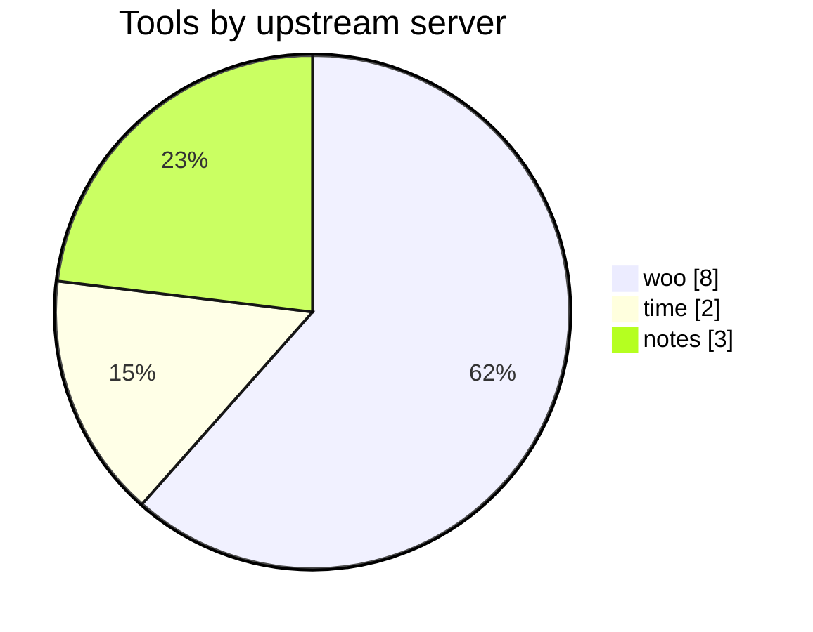

Passing tests per suite:

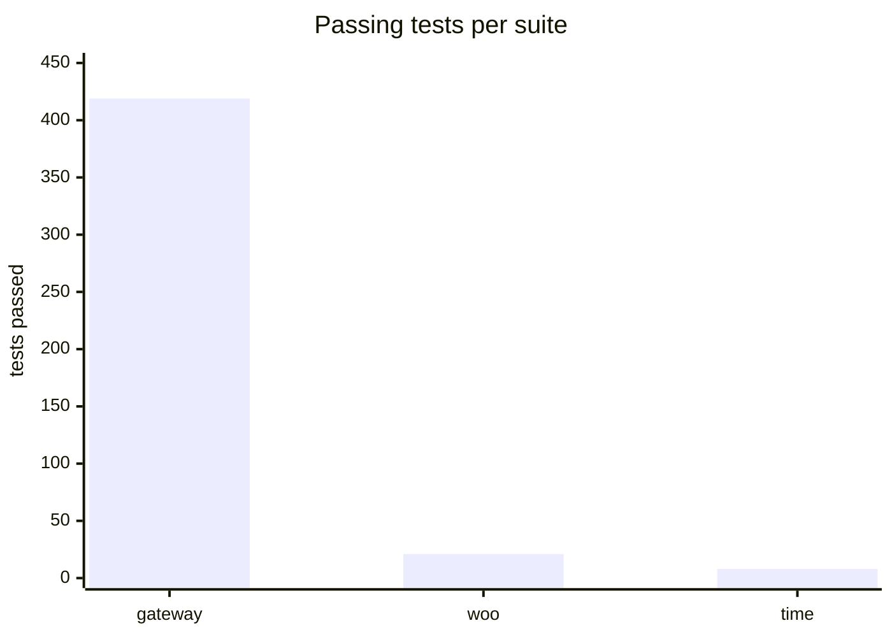

## Requirement coverage

Status legend: **VERIFIED IN REPO** (file or command evidence below), **LIVE ONLY** (owner verified on the VPS), **GAP** (missing). The cheap checks run for real: `make test`, `helm template` greps, and `scripts/check-workload-hardening.py`.

| Requirement | Status | Evidence |
|---|---|---|
| A1 dashboard shows registered servers with status and tools | VERIFIED IN REPO | `src/dashboard/src/pages/Servers.tsx`, `src/gateway/routes/servers.py`, `src/gateway/gw_mcp/health_state.py` |
| A2 Woo MCP already registered as the first server | VERIFIED IN REPO | seeded in `src/gateway`, `helm/values.yaml` |
| A3 add, edit, disable, remove a server by URL and credential | VERIFIED IN REPO | `src/gateway/routes/servers.py`, dashboard Servers page |
| A4 invite members, issue and revoke API keys | VERIFIED IN REPO | `src/gateway/routes/members.py`, `src/gateway/routes/keys.py` |
| A5 audit log of every call | VERIFIED IN REPO | `audit_logs` table in `src/gateway/db/models.py`, async audit queue |
| M1 member generates own API key | VERIFIED IN REPO | `src/gateway/routes/keys.py` |
| M2 one gateway URL plus key shows all enabled tools | VERIFIED IN REPO | `src/gateway/routes/mcp.py`, gateway tests |
| M3 chat agent uses the same tools | VERIFIED IN REPO | `src/gateway/chat/agent.py` |
| M4 member never sees upstream credentials | VERIFIED IN REPO | masking in `src/gateway/routes/servers.py`, credential at rest tests |
| Storefront COD checkout and order visible in Woo Admin | LIVE ONLY | DoD item 1, owner verified on the VPS |
| Chat agent as user A creates a product, order placed, agent lists it | LIVE ONLY | DoD item 2 |
| External client as user B sees all enabled tools and answers | LIVE ONLY | DoD item 3 |
| Revoke B key and next call rejected | LIVE ONLY | DoD item 4 |
| Disable one upstream and its tools vanish | LIVE ONLY | DoD item 5 |
| Kill an upstream pod, others keep working | LIVE ONLY | DoD item 6 |
| Every call in the audit log under the right user | LIVE ONLY | DoD item 7 |
| Compare orders across two stores then delete one | GAP | owner still to verify live (bonus) |
| OAuth with a real client | GAP | owner still to verify live |
| Local kind cluster | VERIFIED IN REPO | `kind-config.yaml`, `make kind-up` |
| Deployable to k3s with the same charts | VERIFIED IN REPO | `helm/values-prod.yaml`, `docs/DEPLOY_VPS.md` |
| Helm only, no Kustomize | VERIFIED IN REPO | no `kustomization` files anywhere |
| `values-local` and `values-prod` | VERIFIED IN REPO | `helm/values-local.yaml`, `helm/values-prod.yaml` |
| Everything runs in cluster | VERIFIED IN REPO | rendered chart workloads, `make ps` |
| Persistent storage for DB and WordPress | VERIFIED IN REPO | PVC templates, `scripts/check-workload-hardening.py` |
| Ingress with stable URLs and local domain | VERIFIED IN REPO | `helm/templates/ingress-*.yaml`, nip.io |
| Probes and limits on every workload | VERIFIED IN REPO | `scripts/check-workload-hardening.py` (table above) |
| No hardcoded secrets, credentials in Secrets | VERIFIED IN REPO | Secret templates, `scripts/smoke-images.sh` |
| Woo MCP written by us, Streamable HTTP, 8 tools | VERIFIED IN REPO | `src/woo-mcp`, tool names in source |
| Woo MCP not reachable from outside the cluster | VERIFIED IN REPO | ClusterIP, no Ingress, `urumi-allow-gateway-to-woo-mcp` |
| Gateway aggregation, timeouts, clear errors | VERIFIED IN REPO | `src/gateway/gw_mcp`, gateway tests |
| Same name collision handling | VERIFIED IN REPO | `slug__tool`, gateway tests |
| At least three upstream servers | VERIFIED IN REPO | woo, time, notes seeded |
| Roles admin and member | VERIFIED IN REPO | `src/gateway/db/models.py` |
| Per user keys hashed, shown once, revocable | VERIFIED IN REPO | `src/gateway/routes/keys.py` |
| Audit with user, server, tool, time, duration, outcome | VERIFIED IN REPO | `audit_logs` model |
| Chat agent acts as the user, LLM key in a Secret | VERIFIED IN REPO | `src/gateway/chat/agent.py`, Secret template |
| Tool output treated as untrusted data | VERIFIED IN REPO | THREAT_MODEL.md, sanitising |
| Multi store provisioning with status and teardown | VERIFIED IN REPO | `src/gateway/stores`, `src/provisioner` |
| Per store namespace, DB, Secrets, PVCs, Ingress | VERIFIED IN REPO | `helm/store`, provisioner |
| Automatic MCP registration with store tool names | VERIFIED IN REPO | `src/gateway/stores`, `<slug>__` tools |
| Clean teardown of namespace, volumes, Secrets, registration | VERIFIED IN REPO | `src/provisioner`, DELETING label flow |
| Isolation with NetworkPolicies, ResourceQuota and LimitRange | VERIFIED IN REPO | `helm/store`, provisioner |
| Max stores per user, provisioning timeout | VERIFIED IN REPO | `stores.maxPerUser`, `stores.maxConcurrent`, provisioner |
| Recovery and safe retry after provisioner restart | VERIFIED IN REPO | cluster derived state in `src/gateway/stores` |
| VPS deployment with documented values and TLS | VERIFIED IN REPO | `docs/DEPLOY_VPS.md`, `helm/values-prod.yaml` |
| Tool permissions (hidden and rejected) | VERIFIED IN REPO | `src/gateway/gw_mcp/permissions.py` |
| OAuth on the gateway | VERIFIED IN REPO | `src/gateway/oauth`, `scripts/phase7-oauth-gate.sh` |
| Handling many tools | VERIFIED IN REPO | compact mode, `search_tools` meta tool |
| Hosted MCP servers by image | VERIFIED IN REPO | `src/gateway/hosted`, `src/provisioner` |
| Security hardening | VERIFIED IN REPO | SSRF guard, RBAC, NetworkPolicies, non root, encrypted credentials |
| Scaling (more than one replica, rate limits) | VERIFIED IN REPO | replica safe rate limits in Postgres |
| Observability (metrics, clear failure reasons) | VERIFIED IN REPO | `/metrics`, Metrics page, failure classifications |
| Upgrades and rollback | VERIFIED IN REPO | `docs/UPGRADE_ROLLBACK.md`, `src/gateway/db/schema_check.py` |
| D1 README with local and VPS setup | VERIFIED IN REPO | this README, `docs/DEPLOY_VPS.md` |
| D1 source for dashboard, backend, gateway, woo mcp, chat | VERIFIED IN REPO | `src/dashboard`, `src/gateway`, `src/woo-mcp` |
| D1 Helm charts and values local and production | VERIFIED IN REPO | `helm/`, `helm/values-local.yaml`, `helm/values-prod.yaml` |
| D2 system design and tradeoffs note | VERIFIED IN REPO | `SYSTEM_DESIGN_AND_TRADEOFFS.md` |
| D3 threat model note | VERIFIED IN REPO | `THREAT_MODEL.md` |
| D4 list of bonus and stand out items | VERIFIED IN REPO | Stand out items table above, `docs/DECISIONS.md` |

## Verification

| Gate | Command | What it proves |
|---|---|---|
| Lint | `make lint` | helm lint x3, chart parity, doc links, prose style, workload hardening, ruff |
| Unit tests | `make test` | gateway 419 passed + 2 skipped, woo mcp 21, demo time 8 |
| Chart render | `helm template urumi ./helm -n urumi -f helm/values-local.yaml` | exact YAML the cluster gets |
| Store + COD + MCP + gateway live gates | `make verify-store verify-cod verify-mcp verify-gateway` | storefront, checkout, MCP handshake, routing |
| Full DoD on kind | `bash scripts/regress-core.sh` | the core demo path end to end |
| Security table + live probes | `bash scripts/verify-hardening.sh` | per workload security posture (53 checks) |
| Chat LLM | `make verify-llm` | streams, tool loop, wrong key error |
| OAuth full flow | `bash scripts/phase7-oauth-gate.sh` | metadata, registration, consent, token, revoke |
| Landing gates | `make landing-verify`, `make landing-graphics` | CSP and console clean against the real nginx image |
| Demo reset | `make demo-reset` (dry run) / `CONFIRM=yes` | restore the demo state |

## Repository map

```
Makefile                  targets: cluster, images, helm, verify, tests
README.md                 this file
THREAT_MODEL.md            security note (deliverable D3)
SYSTEM_DESIGN_AND_TRADEOFFS.md  architecture note (deliverable D2)
helm/                     the single Helm umbrella chart and values files
helm/store                per store chart baked into the provisioner
src/gateway               FastAPI: MCP server, admin REST, chat agent, stores, hosted, OAuth
src/dashboard             React + Vite + TypeScript dashboard
src/woo-mcp               custom WooCommerce MCP server (8 tools)
src/demo-mcp-time         demo upstream (2 tools)
src/demo-mcp-notes        demo upstream (3 tools)
src/provisioner           namespace provisioner for stores and hosted servers
src/landing               zero request static landing page
src/wordpress, src/wp-cli hardened WordPress images
store/                    storefront theme, product catalogue and photos
scripts/                  verification and maintenance scripts
docs/                     DECISIONS, DEPLOY_VPS, UPGRADE_ROLLBACK and reference notes
docs/assets/              README banner and screenshots
```

## Known limitations (honest)

- **Helm rollback vs forward only migrations:** a rollback across a migration boundary leaves the database ahead of the code and the rolled back gateway refuses to serve by design (ERROR log, `/readyz` unready, exit 3). Recovery is the pre upgrade `pg_dump` or reapplying the newer release.
- **Light theme chart bar contrast:** dashboard light mode chart bars measure 1.52:1 against the white card (pre existing approved light design); the same data is always available as text. Dark bars pass the 3:1 graphics minimum.
- **Provisioner ClusterRole:** cluster scoped by necessity (RBAC cannot filter namespaces by label); a compromised provisioner ServiceAccount can read secrets cluster wide, confined only by code level label guards. Stated plainly in THREAT_MODEL.md.
- Rate limit, lockout and LLM cooldown counters are per replica (in memory); gateway egress is open to public 443 for the LLM provider; the LLM provider sees chat text and images; `readOnlyRootFilesystem` stays false for wordpress, mariadb and `wp-setup` (non root still holds).
- Per store provisioning is capped (`stores.maxConcurrent`) because the local node has 2 CPUs; production uses the same guardrail.

## Documentation index

| Doc | Read when |
|---|---|
| `SYSTEM_DESIGN_AND_TRADEOFFS.md` | architecture, failure handling, production deltas, upgrade and rollback |
| `THREAT_MODEL.md` | assets, member and credential threats, SSRF, provisioner residual, OAuth |
| `docs/DECISIONS.md` | the full ADR log with rejected alternatives |
| `docs/DEPLOY_VPS.md` | stranger runnable VPS walkthrough (k3s, DNS, TLS, first install) |
| `docs/UPGRADE_ROLLBACK.md` | rehearsed upgrade, rollback and pg dump drill |
| `docs/ENDPOINT_MATRIX.md` | every dashboard tile mapped to its endpoint |
| `docs/06_KUBERNETES_AND_HELM.md` | Kubernetes layout and Helm notes |
| `docs/11_OBSERVABILITY.md` | metrics, failure reasons, alerting |
| `docs/STORE_DESIGN.md` | storefront theme and design tokens |
| `docs/LANDING_DESIGN.md` | landing page design source of truth |
| `docs/IMAGE_CREDITS.md` | store photo and banner attribution |
| `docs/FONT_CREDITS.md` | font licenses |
