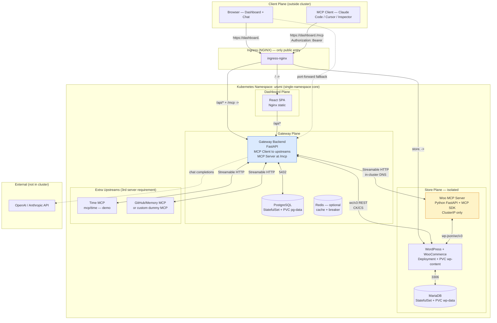
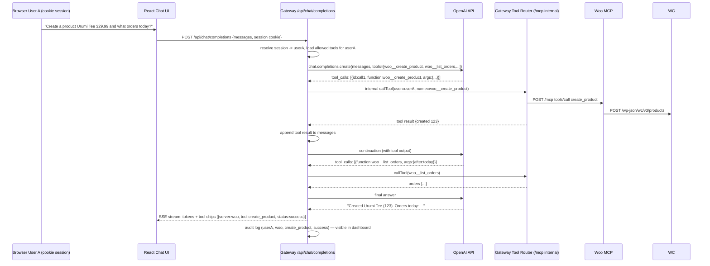

# 01 — System Architecture & Blueprint

## 1. High-Level Architecture (4 layers)



### 1.1 Why single namespace for core (and multi-namespace for bonus)

- **Core:** Everything in `urumi` namespace — simpler Helm, single `values-*.yaml`, easier NetworkPolicy reasoning (label selectors).
- **Bonus multi-store:** Each store gets its own namespace `store-<slug>` with isolated `NetworkPolicy`, `ResourceQuota`, `LimitRange`, `PVC`s, `Secret`s, and its own `woo-mcp` Deployment. Gateway watches via `informer` or polling `GET /api/stores`.

---

## 2. Request Flows (the 3 surfaces reviewers will trace)

### 2.1 External MCP Client -> Gateway -> Woo MCP -> WooCommerce

```mermaid
sequenceDiagram
  participant C as MCP Client
  participant GW as Gateway /mcp (FastAPI)
  participant REG as Registry + Health
  participant CACHE as Tool Cache
  participant W as Woo MCP /mcp
  participant WC as WooCommerce REST

  Note over C,GW: 1. Initialize handshake
  C->>GW: POST /mcp {jsonrpc: initialize, protocolVersion}
  GW->>GW: verifyApiKey(Bearer) -> user, rate-limit, SSRF check
  GW-->>C: {result: capabilities.tools, serverInfo: gateway}
  C->>GW: notifications/initialized

  Note over C,GW: 2. Discover tools (aggregated)
  C->>GW: POST /mcp {method: tools/list}
  GW->>REG: fan-out asyncio.gather with per-server timeout 8s
  REG->>W: POST /mcp {tools/list} (internal, mTLS/DNS)
  REG->>TIME: POST /mcp {tools/list}
  W-->>REG: [{name:list_products},{name:create_product},...]
  TIME-->>REG: [{name:get_current_time}]
  REG-->>CACHE: upsert exposed_name = slug__tool
  GW-->>C: {tools: [woo__list_products, woo__create_product, time__get_current_time]}

  Note over C,GW: 3. Call tool (routed)
  C->>GW: POST /mcp {method: tools/call, params: {name: woo__create_product, arguments:{name:Tee, price:29.99}}}
  GW->>GW: authz canCall(user, woo__create_product)?, validate inputSchema, audit start
  GW->>W: POST /mcp {method: tools/call, params:{name:create_product, arguments:{...}}}<br/>strip prefix, inject upstream cred (server-side)
  W->>WC: POST /wp-json/wc/v3/products {name, regular_price} + Basic CK/CS
  WC-->>W: 201 {id:123, name:Tee}
  W-->>GW: {content:[{type:text,text:Created product 123}], isError:false}
  GW->>GW: audit success, duration
  GW-->>C: {result: {content:[...]}}

  Note over C,GW: 4. Failure isolation
  C->>GW: POST /mcp {tools/call, name: time__get_current_time}
  GW->>TIME: POST /mcp ...
  TIME--xGW: timeout 10s
  GW->>GW: circuit breaker increment, audit timeout
  GW-->>C: {error: -32000, message: upstream time timed out}
  Note over GW: other servers unaffected; tools/list still returns woo tools
```

**Key to explain in interview:** Gateway is **stateless per-request** (ephemeral `httpx.AsyncClient` or `streamablehttp_client` per call). No sticky session → scales to N replicas. Tool prefix `woo__` is gateway's **collision scheme** documented.

### 2.2 Chat Agent (dashboard) -> Gateway (as user) -> Upstreams



**Interview point:** Agent **acts as logged-in user** — not service account. Audit shows `userA`. Browser never sees upstream creds or raw MCP frames.

### 2.3 Admin Dashboard CRUD

```
Browser -> Gateway /api/* (REST, JSON, session cookie + CSRF)
  GET    /api/servers              -> list {id, slug, url, status, tools[], enabled, created_at} (credential masked)
  POST   /api/servers              -> validateUrl SSRF, encrypt credential, health probe async, return 201
  PATCH  /api/servers/:id          -> re-validate URL, re-encrypt if credential supplied
  POST   /api/servers/:id/disable  -> enabled=false, invalidate cache, tools vanish from /mcp
  DELETE /api/servers/:id
  GET    /api/servers/:id/health   -> live probe
  GET    /api/users, POST /api/users, POST /api/users/:id/keys, DELETE /api/keys/:id (revoke)
  GET    /api/audit?user=&server=&tool=&from=&to=  -> paginated audit
  GET    /api/tools                -> aggregated catalog for chat (filtered by role)
```

---

## 3. Component Breakdown

### 3.1 WooCommerce MCP Server (`src/woo-mcp/`)

- **Stack:** Python 3.12, FastAPI, `mcp` SDK `StreamableHTTPSessionManager`, `httpx`, `pydantic`.
- **Responsibility:** Translate MCP tool calls -> Woo REST API. No direct DB access (preserves Woo hooks).
- **Tools:**
  ```
  woo__list_products     {search?, status?, per_page?, page?}
  woo__get_product       {id}
  woo__create_product    {name, regular_price, description?, sku?, type?}
  woo__list_orders       {after?, before?, status?, per_page?}
  woo__get_order         {id}
  woo__update_order_status {id, status: pending|processing|on-hold|completed|cancelled|refunded|failed}
  ```
  (Min 5 required; 6 included, `get_product` useful for chat verification)
- **Auth to Woo:** Consumer Key/Secret via `Authorization: Basic base64(ck:cs)` from env `WOO_CK/CS` (K8s Secret).
- **Probes:** `/healthz` (always 200), `/readyz` (probes `GET /wp-json/wc/v3/products?per_page=1`).
- **Security:** `ClusterIP` only, `NetworkPolicy` ingress from `gateway` label only, `runAsNonRoot`.

### 3.2 Gateway Backend (`src/gateway/`)

```
gateway/
  main.py              # FastAPI app, lifespan (health loop, audit worker)
  config.py            # pydantic-settings (DATABASE_URL, FERNET_KEY, LLM keys)
  db/                  # SQLAlchemy async models + Alembic
  auth/                # API key hashing (argon2id), RBAC dependency, session
  registry/            # servers CRUD, SSRF validator, credential encryption
  mcp/                 # aggregation, routing, prefix collision, timeout/circuit breaker
  audit/               # async queue + writer
  chat/                # LLM tool loop, prompt, streaming
  routes/              # /mcp, /api/servers, /api/users, /api/keys, /api/audit, /api/chat
```

- **Dual role:** `mcp/client` (httpx to upstreams) + `mcp/server` (exposes `/mcp`).
- **Stateless scaling:** Per-call `streamablehttp_client` (no sticky session). Health cache in Postgres + in-memory TTL 15s.
- **Collision:** `exposed_name = f"{slug}__{original}"` (e.g. `woo__list_products`). Mapping persisted in `tools` table for audit + description prefix `[woo]`.

### 3.3 Dashboard (`src/dashboard/`)

- **Stack:** React 18 + Vite + TypeScript + Tailwind + TanStack Query + React Router + `zod`.
- **Pages:** Login, Servers (status badges, tool drawer), Members & Keys, Audit Log (table + filters), Chat, Store link.
- **Auth:** Session cookie (HttpOnly) for dashboard; `Authorization: Bearer <key>` for `/mcp` (separate). CSRF token for mutating `/api/*`.
- **MCP visibility:** `GET /api/tools` returns allowed tools for current user (same filtering as `/mcp tools/list`).

### 3.4 PostgreSQL (`postgres:16-alpine`)

- **Why not SQLite:** Audit needs concurrent writes from N gateway replicas; SQLite writer lock would serialize and drop under load. PG partitioning + `BRIN` for audit scale.
- **PVC:** 5Gi `RWO` (local) / 20Gi (prod), `pg-data`.

### 3.5 Ingress & DNS

- **Hosts:** `store.<domain>` -> `wordpress:80`, `dashboard.<domain>` -> `gateway:8000` + `dashboard:80` (path routing `/api`, `/mcp` -> gateway, `/` -> dashboard).
- **Local domain:** `*.127.0.0.1.nip.io` (zero hosts edit) OR `woo.localtest.me` with `/etc/hosts 127.0.0.1` + Kind `extraPortMappings: 80:80, 443:443`.

---

## 4. Namespace & Resource Topology

```
Namespace: urumi
  Secret:      gateway-secrets (FERNET_KEY, DATABASE_URL, LLM keys)
               woo-secrets (WOO_CK, WOO_CS, WOO_URL)
               mariadb-secret, pg-secret, wp-secret
  PVC:         wp-content-pvc, wp-data-pvc, pg-data-pvc
  Deployment:  wordpress (1 replica, PVC wp-content)
  StatefulSet: mariadb (1 replica, PVC wp-data)
  Deployment:  woo-mcp (1 replica)
  Deployment:  gateway (1 local / 2 prod replicas)
  Deployment:  dashboard (1 replica, nginx)
  Service:     wordpress (ClusterIP), mariadb (ClusterIP), woo-mcp (ClusterIP), gateway (ClusterIP), dashboard (ClusterIP), postgres (ClusterIP)
  Ingress:     urumi-ingress (2 hosts)
  NetworkPolicy: default-deny, allow-gateway->woo-mcp, allow-wordpress->mariadb, allow-ingress->gateway/dashboard/wordpress
  ResourceQuota/LimitRange: optional (bonus per-store)
  Job:         wp-setup (Helm post-install hook: wp core install + wc install + seed)
```

**Resource requests/limits (example):**
| Workload | requests | limits |
|---|---|---|
| wordpress | 200m / 256Mi | 500m / 512Mi |
| mariadb | 200m / 256Mi | 500m / 512Mi |
| woo-mcp | 100m / 128Mi | 300m / 256Mi |
| gateway | 200m / 256Mi | 500m / 512Mi |
| dashboard | 50m / 64Mi | 200m / 128Mi |
| postgres | 200m / 256Mi | 500m / 512Mi |

---

## 5. Technology Choices & Rationale

| Decision | Choice | Why |
|---|---|---|
| Woo API | REST `wc/v3` + CK/CS | No extra plugin, stable, Woo hooks preserved; WP-CLI only for seeding Job |
| MCP transport | Streamable HTTP (2025-03-26) | Spec current, single endpoint, JSON + SSE, SDK native |
| Aggregation pattern | Prefix `slug__tool` | Deterministic, no collision, LLM-friendly, easy audit routing |
| Timeout isolation | `httpx.Timeout` + `asyncio.wait_for(10s)` + `gather(return_exceptions)` | Dead server never blocks healthy; circuit breaker for repeated fails |
| API key storage | `argon2id` hash + `sha256` lookup column | Hashed at rest, indexed lookup, constant-time verify |
| Credential encryption | Fernet (key from Secret, rotation via `key_id`) | Simple, at-rest encryption, never logged |
| DB | Postgres + async SQLAlchemy | Concurrent audit, multi-replica safe, partitioning |
| Chat LLM | OpenAI `gpt-4o-mini` (env switch to Anthropic/Ollama) | Cheap, tool calling mature, free tier suffices |
| Helm structure | Umbrella chart `helm/` with `values-local.yaml`/`values-prod.yaml` | Same chart both envs per requirement |
| Local K8s | Kind | Fast, `extraPortMappings`, CI-friendly; k3s on VPS for parity |

---

## 6. Non-Functional Guarantees

- **Isolation:** `NetworkPolicy` deny-by-default; woo-mcp not exposed via Ingress; gateway egress SSRF validated.
- **Observability:** Structured logs (structlog), `X-Request-ID` propagation, Prometheus `/metrics` (tool latency histogram, circuit state).
- **Upgrades:** `helm upgrade --install --atomic --timeout 5m`; DB migrations via `Job` with `helm.sh/hook-weight: -5`.
- **Rollback:** `helm rollback urumi 1`; gateway is stateless, rollback is pod image revert.

---

## 7. What Makes This Impressive (first 30s of video)

> "Single Helm chart deploys a full WooCommerce hosting stack + MCP gateway that aggregates any Streamable-HTTP server behind one endpoint, with per-user hashed keys, per-tool RBAC, SSRF-hardened registry, circuit-broken fan-out, and a chat agent that acts as the logged-in user — all running on Kind locally and k3s on VPS with zero chart changes, only values."

That line hits every rubric keyword in one breath.
